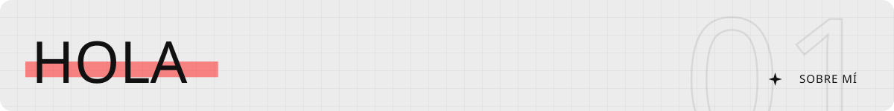
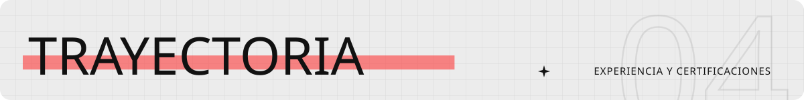
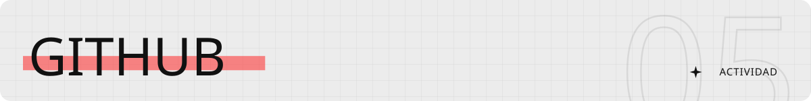
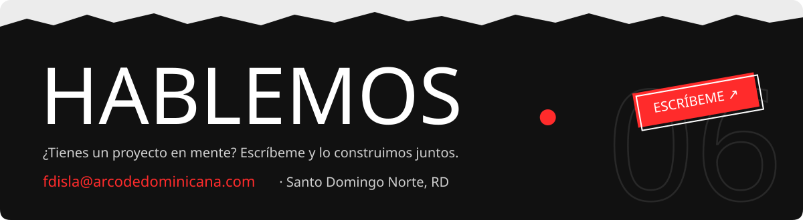

  
  
  
  
  

 

**Hi, soy Franklin Disla.** Cofundador de **Arcode Dominicana** y desarrollador freelance. Me apasiona crear soluciones que le hagan la vida más fácil a la gente, ya sea con Node.js, React o C#, o asegurándome de que todo funcione en los servidores.

<table>
  <tr>
    <td width="33%" align="center"><h3>FULL STACK</h3><code>NODE · REACT · C#</code></td>
    <td width="33%" align="center"><h3>SOPORTE IT</h3><code>SERVIDORES · AD · PROXMOX</code></td>
    <td width="33%" align="center"><h3>SCRUM MASTER</h3><code>CSM · EQUIPOS ÁGILES</code></td>
  </tr>
</table>

<table>
  <tr>
    <td width="72" align="center"><h3>★</h3></td>
    <td>
      <strong>VORTEX — PUNTO DE VENTA</strong> &nbsp;·&nbsp; <code>GRAN PROYECTO</code> &nbsp;<a href="https://vortex-pos.com"><code>VISITAR ↗</code></a> 
      Software de punto de venta para negocios de mostrador: cobras, facturas, descuentas inventario y cierras caja desde la misma pantalla, y administras todas tus sucursales desde un solo lugar. 
      <code>PUNTO DE VENTA</code> <code>INVENTARIO</code> <code>FACTURACIÓN</code> <code>MULTI-SUCURSAL</code>
    </td>
  </tr>
  <tr>
    <td align="center"><h3>01</h3></td>
    <td>
      <strong>SISTEMA DE GESTIÓN HOSPITALARIA</strong> 
      Administración de pacientes, médicos y citas médicas, con control de inventario, reportes y usuarios con distintos roles. 
      <code>NODE.JS</code> <code>REACT</code> <code>SQL SERVER</code> <code>EXPRESS</code>
    </td>
  </tr>
  <tr>
    <td align="center"><h3>02</h3></td>
    <td>
      <strong>SISTEMA CONTROL DE HORAS EXTRAS</strong> 
      Registro y control de horas extras y asistencia de empleados, con reportes detallados para la gestión de nómina. 
      <code>REACT</code> <code>NEST.JS</code> <code>TYPESCRIPT</code> <code>SQL SERVER</code> <code>TAILWIND</code>
    </td>
  </tr>
  <tr>
    <td align="center"><h3>03</h3></td>
    <td>
      <strong>SISTEMA DE ORGANIZACIÓN DE VIAJES</strong> 
      Reservas, clientes, pagos y control de cupos para agencias de viajes, con panel administrativo e historial de excursiones. 
      <code>REACT</code> <code>VITE</code> <code>SUPABASE</code> <code>NODE.JS</code> <code>EXPRESS</code>
    </td>
  </tr>
  <tr>
    <td align="center"><h3>04</h3></td>
    <td>
      <strong>SISTEMA DE GESTIÓN DE INCIDENCIAS</strong> 
      Gestión de incidencias a nivel empresarial: averías, órdenes de trabajo, reportes, control de usuarios y notificaciones. Modo claro y oscuro. 
      <code>REACT</code> <code>C# ASP.NET</code> <code>CLEAN ARCHITECTURE</code> <code>SQL SERVER</code>
    </td>
  </tr>
  <tr>
    <td align="center"><h3>05</h3></td>
    <td>
      <strong>MOVIA — MOVIES &amp; SERIES</strong> &nbsp;<a href="https://movia.arcodedominicana.com/"><code>VISITAR ↗</code></a> 
      Plataforma social de streaming: películas y series con subtítulos, watch parties con amigos, «ver más tarde» e historial, y grupos de contenido con permisos por miembro. 
      <code>REACT</code> <code>EXPRESS</code> <code>MYSQL</code> <code>TAILWIND</code>
    </td>
  </tr>
  <tr>
    <td align="center"><h3>06</h3></td>
    <td>
      <strong>FINLIBRE — FINANZAS PERSONALES</strong> &nbsp;<a href="https://finlibre.arcodedominicana.com/"><code>VISITAR ↗</code></a> 
      Finanzas personales: servicios fijos, deudas con plan para salir de ellas, metas de ahorro y análisis de estados de cuenta con IA. 
      <code>REACT</code> <code>EXPRESS</code> <code>MYSQL</code> <code>TAILWIND</code>
    </td>
  </tr>
</table>

<table>
  <tr>
    <td width="50%" valign="top">
      <strong>DESARROLLO</strong> &nbsp;<code>08</code>  
      
      
      
      
      
      
      
      
    </td>
    <td width="50%" valign="top">
      <strong>DATOS &amp; INFRAESTRUCTURA</strong> &nbsp;<code>07</code>  
      
      
      
      
      
      
      
    </td>
  </tr>
</table>

| Período | Puesto | Empresa |
| :-- | :-- | :-- |
| <code>2026&nbsp;—&nbsp;HOY</code> | **Programador & Soporte Técnico** | Caribe Tours |
| <code>2025&nbsp;—&nbsp;HOY</code> | **Cofundador & Full Stack** | Arcode Dominicana |
| <code>2021&nbsp;—&nbsp;HOY</code> | **Scrum Master & Developer** | Freelance |
| <code>2023&nbsp;—&nbsp;2026</code> | **Encargado de Soporte Técnico** | TSI Dominicana |

| # | Certificación |
| :-- | :-- |
| `01` | **Certified Scrum Master (CSM)** |
| `02` | **Administración de Windows Server** |
| `03` | **Especialista en Active Directory** |
| `04` | **Desarrollo de Plugins WordPress** |

**Educación:** Administración de Empresas — Instituto Tecnológico de Las Américas (ITLA)

